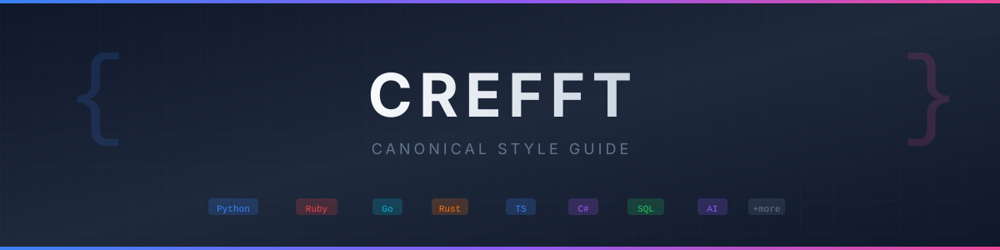

# crefft

**Version: 2026.10.3** | [Changelog](CHANGELOG.md) | [AGENTS.md](AGENTS.md)

*crefft* (Welsh: craft) is the canonical style guide for
all projects. Vendored from
[Google Style Guides](https://github.com/google/styleguide) with
project-specific tooling and conventions. The guides record crefft's tool
choices; read each pin alongside its review evidence.

The key words "MUST", "MUST NOT", "REQUIRED", "SHALL", "SHALL NOT",
"SHOULD", "SHOULD NOT", "RECOMMENDED", "MAY", and "OPTIONAL" in this
document are to be interpreted as described in [RFC 2119](https://datatracker.ietf.org/doc/html/rfc2119).

**All projects MUST follow:**

- [Versioning](guides/process/versioning.md): Semantic Versioning 2.0.0 for
  libraries in every ecosystem; calendar versioning (`YYYY.M.N`) for everything else
- [Keep a Changelog](https://keepachangelog.com/en/1.1.0/)
- [Conventional Commits](https://www.conventionalcommits.org/en/v1.0.0/)

See [versioning guide](guides/process/versioning.md) for details.

---

## Language Guides

Every category is indexed in [guides/README.md](guides/README.md).

| Language | Guide | Upstream |
| -------- | ----- | -------- |
| Overview | [guides/languages/README.md](guides/languages/README.md) | — |
| Python | [guides/languages/python.md](guides/languages/python.md) | [Google](reference/google/python.md) |
| Ruby | [guides/languages/ruby.md](guides/languages/ruby.md) | Community |
| Go | [guides/languages/go.md](guides/languages/go.md) | [Google](reference/google/go.md) |
| Rust | [guides/languages/rust.md](guides/languages/rust.md) | Official |
| Rust: topic index | [guides/languages/rust/README.md](guides/languages/rust/README.md) | Official |
| Rust: Rust API Design | [guides/languages/rust/api-design.md](guides/languages/rust/api-design.md) | Official |
| Rust: Async Runtimes | [guides/languages/rust/async.md](guides/languages/rust/async.md) | Official |
| Rust: Cargo Features | [guides/languages/rust/features.md](guides/languages/rust/features.md) | Official |
| Rust: Procedural Macros | [guides/languages/rust/macros.md](guides/languages/rust/macros.md) | Official |
| Rust: Rust Testing Tools | [guides/languages/rust/testing.md](guides/languages/rust/testing.md) | Official |
| Rust: Rust Testing Scenarios | [guides/languages/rust/testing-scenarios.md](guides/languages/rust/testing-scenarios.md) | Official |
| Rust: Unsafe Rust | [guides/languages/rust/unsafe.md](guides/languages/rust/unsafe.md) | Official |
| Rust: WebAssembly | [guides/languages/rust/wasm.md](guides/languages/rust/wasm.md) | Official |
| Rust: CI Pipeline | [guides/languages/rust/ci.md](guides/languages/rust/ci.md) | Official |
| Rust: Dependencies and Supply Chain | [guides/languages/rust/dependencies.md](guides/languages/rust/dependencies.md) | Official |
| Rust: Tested Version Matrix | [guides/languages/rust/versions.md](guides/languages/rust/versions.md) | Official |
| TypeScript | [guides/languages/typescript.md](guides/languages/typescript.md) | [Google](reference/google/typescript.html) |
| C# | [guides/languages/csharp.md](guides/languages/csharp.md) | [Google](reference/google/csharp.md) |
| .NET | [guides/languages/dotnet.md](guides/languages/dotnet.md) | Microsoft |
| SQL | [guides/languages/sql.md](guides/languages/sql.md) | Community |
| Shell | [guides/languages/shell.md](guides/languages/shell.md) | [Google](reference/google/shell.md) |
| CSS | [guides/languages/css.md](guides/languages/css.md) | [Google](reference/google/htmlcss.html) |

## Framework Guides

| Framework | Guide | Language |
| --------- | ----- | -------- |
| Overview | [guides/frameworks/README.md](guides/frameworks/README.md) | — |
| Axum | [guides/frameworks/axum.md](guides/frameworks/axum.md) | Rust |
| Django | [guides/frameworks/django.md](guides/frameworks/django.md) | Python |
| FastAPI | [guides/frameworks/fastapi.md](guides/frameworks/fastapi.md) | Python |
| Flask | [guides/frameworks/flask.md](guides/frameworks/flask.md) | Python |
| Gin | [guides/frameworks/gin.md](guides/frameworks/gin.md) | Go |
| Hanami | [guides/frameworks/hanami.md](guides/frameworks/hanami.md) | Ruby |
| Next.js | [guides/frameworks/nextjs.md](guides/frameworks/nextjs.md) | TypeScript |
| Rails | [guides/frameworks/rails.md](guides/frameworks/rails.md) | Ruby |
| React | [guides/frameworks/react.md](guides/frameworks/react.md) | TypeScript |
| Sinatra | [guides/frameworks/sinatra.md](guides/frameworks/sinatra.md) | Ruby |
| Strawberry | [guides/frameworks/strawberry.md](guides/frameworks/strawberry.md) | Python (GraphQL) |
| Tailwind CSS | [guides/frameworks/tailwind.md](guides/frameworks/tailwind.md) | CSS |

## AI-Assisted Development

| Topic | Guide | Description |
| ----- | ----- | ----------- |
| Overview | [guides/ai/README.md](guides/ai/README.md) | When and how to use AI assistance |
| **AI Workflows** | [guides/ai/ai-workflows.md](guides/ai/ai-workflows.md) | Hero Flow, TDD, Visual Iteration |
| Claude | [guides/ai/claude.md](guides/ai/claude.md) | Anthropic Claude best practices |
| OpenAI | [guides/ai/openai.md](guides/ai/openai.md) | OpenAI GPT and Codex best practices |
| Gemini | [guides/ai/gemini.md](guides/ai/gemini.md) | Google Gemini best practices |
| **Claude Code** | [guides/ai/claude-code.md](guides/ai/claude-code.md) | CLI config: hooks, agents, commands |
| **Code Agents** | [guides/ai/code-agents.md](guides/ai/code-agents.md) | 8 agents: review, perf, a11y, API |
| **Security Agents** | [guides/ai/security-agents.md](guides/ai/security-agents.md) | 16 agents: threat modeling, compliance |
| **System Agents** | [guides/ai/system-agents.md](guides/ai/system-agents.md) | 14 agents: Docker, Ansible, networking |
| Release Manager | [guides/ai/release-manager-agent.md](guides/ai/release-manager-agent.md) | Release automation and quality gates |
| Local LLMs | [guides/ai/local-llms.md](guides/ai/local-llms.md) | Ollama, vLLM, Docker Model Runner |
| AGENTS.md | [guides/ai/agents-md.md](guides/ai/agents-md.md) | Project instruction files |
| Security | [guides/ai/security.md](guides/ai/security.md) | LLM security considerations |

## API Design Guides

| Protocol | Guide | Description |
| -------- | ----- | ----------- |
| Overview | [guides/api/README.md](guides/api/README.md) | API design index |
| GraphQL | [guides/api/graphql.md](guides/api/graphql.md) | Schema design, queries, mutations, security |
| REST | [guides/api/rest.md](guides/api/rest.md) | Resources, HTTP methods, status codes, pagination |

## Process Guides

| Topic | Guide |
| ----- | ----- |
| Overview | [guides/process/README.md](guides/process/README.md) |
| Testing | [guides/process/testing.md](guides/process/testing.md) |
| Versioning | [guides/process/versioning.md](guides/process/versioning.md) |
| CI/CD | [guides/process/ci.md](guides/process/ci.md) |
| GitHub Templates | [guides/process/github-templates.md](guides/process/github-templates.md) |

## Design Guides

| Topic | Guide | Description |
| ----- | ----- | ----------- |
| Overview | [guides/design/README.md](guides/design/README.md) | Design principles and process |
| Design Systems | [guides/design/design-systems.md](guides/design/design-systems.md) | Tokens, typography, color, spacing |
| Components | [guides/design/components.md](guides/design/components.md) | Reusable component patterns |
| Accessibility | [guides/design/accessibility.md](guides/design/accessibility.md) | WCAG compliance and inclusive design |
| Motion | [guides/design/motion.md](guides/design/motion.md) | Animation and interaction feedback |

## Infrastructure Guides

| Topic | Guide |
| ----- | ----- |
| Overview | [guides/infrastructure/README.md](guides/infrastructure/README.md) |
| **Operating Systems** | |
| Fundamentals | [guides/infrastructure/os/README.md](guides/infrastructure/os/README.md) |
| Linux (Debian) | [guides/infrastructure/os/linux.md](guides/infrastructure/os/linux.md) |
| **Services** | |
| Services Overview | [guides/infrastructure/services/README.md](guides/infrastructure/services/README.md) |
| SSH | [guides/infrastructure/services/ssh.md](guides/infrastructure/services/ssh.md) |
| NTP | [guides/infrastructure/services/ntp.md](guides/infrastructure/services/ntp.md) |
| DNS | [guides/infrastructure/services/dns.md](guides/infrastructure/services/dns.md) |
| Firewall (nftables) | [guides/infrastructure/services/nftables.md](guides/infrastructure/services/nftables.md) |
| Logging | [guides/infrastructure/services/logging.md](guides/infrastructure/services/logging.md) |
| **Infrastructure as Code** | |
| Ansible | [guides/infrastructure/ansible.md](guides/infrastructure/ansible.md) |
| Docker | [guides/infrastructure/docker.md](guides/infrastructure/docker.md) |

## Documentation

| Topic | Guide |
| ----- | ----- |
| Overview | [guides/docs/README.md](guides/docs/README.md) |
| Markdown | [guides/docs/markdown.md](guides/docs/markdown.md) |
| Specifications | [guides/docs/specifications.md](guides/docs/specifications.md) |

---

## What Each Language Guide Covers

Every language guide **MUST** include:

| Category | Topics |
| -------- | ------ |
| **Code Quality** | Lint, Format, Type Check, Semantic Analysis, Dead Code |
| **Testing** | Unit, Integration, E2E, Acceptance, Performance |
| **Advanced Testing** | Thread Safety, Idempotence, Reliability, Compatibility |
| **Specialized** | i18n/UTF-8, Data Integrity, A/B Testing, Feature Flags |
| **Dependencies** | Package Manager, Lock Files, Vulnerability Scanning |

---

## Quick Reference: Tooling by Language

| Language | Lint | Format | Type Check | Coverage | Fuzz |
| -------- | ---- | ------ | ---------- | -------- | ---- |
| Python | Ruff | Ruff | Mypy, Pyright | pytest-cov | Hypothesis |
| Ruby | StandardRB | StandardRB | Sorbet | SimpleCov | - |
| Go | golangci-lint | gofmt | built-in | go test -cover | native |
| Rust | Clippy | rustfmt | built-in | cargo-tarpaulin | cargo-fuzz |
| C# | Roslynator | dotnet format | built-in | coverlet | SharpFuzz |
| TypeScript | Biome | Biome | built-in | c8 | - |
| SQL | SQLFluff | SQLFluff | - | - | - |
| Shell | shellcheck | shfmt | - | bashcov | - |
| CSS | Stylelint | Prettier | - | - | - |

---

## Tool Selection Rationale

### Python: Ruff

Ruff is a Python linter and formatter written in Rust, 10-100x faster than
alternatives. It replaces Flake8, isort, Black, and many other tools with a
single binary. The Python guide uses uv for package management and Ruff for
linting and formatting.

### Ruby: StandardRB

StandardRB provides zero-config linting built on RuboCop. The Ruby guide uses
StandardRB's shared style. For teams needing custom rules, use RuboCop directly
with StandardRB's config as a base.

### Go: golangci-lint

golangci-lint is a meta-linter aggregating 120+ linters including Staticcheck,
gosec, and govet. It is 5x faster than running linters separately and is the
de facto standard used by Kubernetes, Prometheus, and Terraform.

### Rust: Clippy + rustfmt

Clippy is the official Rust linter with 750+ lints. rustfmt is the official
formatter. Both are included with the Rust toolchain. The Rust guide requires
Clippy and rustfmt.

### C#/.NET: Roslynator + dotnet format

Roslynator provides 500+ analyzers and refactorings. dotnet format (built into
.NET SDK 6+) handles formatting via EditorConfig. Add SonarAnalyzer.CSharp for
security analysis.

### TypeScript: Biome

Biome is 20x faster than ESLint+Prettier and combines linting and formatting.
For legacy projects or those needing extensive plugin ecosystems, ESLint
remains viable.

### SQL: SQLFluff

SQLFluff is the most popular SQL linter, supporting PostgreSQL, MySQL, SQLite,
and 20+ dialects. It parses SQL to catch syntax issues and auto-fixes most
problems.

---

## Configuration Files

Ready-to-copy configuration files:

| Config | Path | Purpose |
| ------ | ---- | ------- |
| **Agents** | [agents/](agents/) | 53 agents across 6 families |
| **Commands** | [commands/](commands/) | 18 slash commands (`/code`, `/security`, ...) |
| Ansible | [configs/ansible/](configs/ansible/) | Ansible configuration templates |
| AGENTS.md | [configs/agents/AGENTS.md.template](configs/agents/AGENTS.md.template) | AI assistant context |
| **Claude Code** | [configs/claude/](configs/claude/) | Hooks, settings, MCP config |
| EditorConfig | [configs/editorconfig/.editorconfig](configs/editorconfig/.editorconfig) | Editor settings |
| Pre-commit | [configs/pre-commit/.pre-commit-config.yaml](configs/pre-commit/.pre-commit-config.yaml) | Git hooks |
| Prettier | [configs/prettier/.prettierrc](configs/prettier/.prettierrc) | Code formatting |
| Vale | [`configs/vale/`](configs/vale/README.md) | Crefft writing rules and release package |
| **crefft Sync** | [.github/workflows/sync-crefft.yml](configs/github/workflows/sync-crefft.yml) | Auto-sync configs to projects |

---

## Checking executable pins

Copyable tool installs **MUST** name an exact version. Runnable containers
**MUST** use complete SHA-256 digests or exact release tags with a registry-verification
note, never a major-version alias, `:latest`, or an implicit latest tag. Every
`uses:` reference **MUST** name a full 40-character commit SHA with a trailing
version comment, including reusable workflows. New pins **MUST** be verified
against the upstream tag or container registry. Shared tool and action pins
**MUST** be registered in
[`configs/tool-versions.json`](configs/tool-versions.json). Existing
[`pre-commit pins`](configs/pre-commit/.pre-commit-config.yaml) take precedence
for overlapping tools.

**Why**: A floating install can change the copied command's behavior without
any change to the guide or pipeline.

`python3 scripts/validate_versions.py` checks these rules during `make check`
and CI, without network requests. It scans `guides/`, `agents/`, `commands/`,
and `configs/`: `bash`, `sh`, `shell`, `console`, and `zsh` fences; Dockerfile
instructions; YAML `run:` steps, `image:` values, and `uses:` actions; and
inline spans beginning with a package-manager command. Native shell,
Dockerfile, and YAML configuration files are checked too. All `uses:` references
in `.github/workflows/` are checked, with no exceptions. YAML examples are
checked even when their fence has a generic syntax-check skip marker.

Action pins **MUST** be resolved with the exact upstream tag, not copied from
memory. Annotated tags **MUST** use the peeled commit (`^{}`), not the tag
object. Image digests **MUST** come from the registry manifest.

**Why**: A tag object's SHA is not the commit GitHub Actions runs. Resolving both
forms also detects a tag that has moved since an earlier review.

```bash
git ls-remote https://github.com/actions/checkout \
  refs/tags/v7.0.1 'refs/tags/v7.0.1^{}'
docker buildx imagetools inspect postgres:16
```

```text
# Don't: a registry alias or missing version resolves again on each launch.
npx example-tool@latest
pip install example-tool

# Do: name the exact release.
npx example-tool@1.2.3
pip install example-tool==1.2.3
```

Prose warnings, comments, and nonexecutable fences are not installs. Local
builds, dependency-manifest installs such as `npm install` without package
arguments, and `pip install -r requirements.txt` are left to the project's
lockfile policy. Locally built application images are not registry releases;
their examples identify the exact local tag produced by the preceding build.
Exact release image tags remain allowed; this check does not
replace the [Docker guide's digest-pinning rule][image-pins].

[image-pins]: guides/infrastructure/docker.md#image-digest-pinning

A negative example that must demonstrate floating behavior **MAY** put
`# crefft: allow-floating -- reason` immediately before the offending command
or YAML image value, inside the same fence or configuration file.
The nonempty reason **MUST** explain why floating is the point of that example.
The marker exempts only the next logical instruction, including its shell
continuations, not a fence, workflow, file, or subsequent command. Every
exemption is listed in text and JSON output.

**Why**: Teaching the failure requires keeping a few unsafe examples, but an
exception must not hide a later install or silently disable the gate.

Nonexecuting YAML illustrations **MAY** use
`# crefft: illustrative -- reason` immediately before one `uses:` or `image:`
reference in a Markdown fence. The nonempty reason **MUST** explain why the
reference is deliberately invalid or unpublished. It exempts that reference
only, not another step, fence, or file, and cannot exempt a native workflow or
configuration file. `allow-floating` cannot exempt an action.

**Why**: The coverage and Rust pinning anti-patterns need moving refs, the SLSA
anti-patterns need nonexistent action refs, and the release-manager interface and Docker
application templates name unpublished components. These are not executable
recommendations; their individual markers explain each exception in checker output.

---

## Reference material

`reference/` holds third-party guides vendored verbatim for offline reading and
comparison. crefft does not modify them; report problems upstream. Google
style guides are licensed under CC-BY 3.0.

| Vendored file | Upstream project |
| ------------- | ---------------- |
| [reference/airbnb/css-in-javascript.md](reference/airbnb/css-in-javascript.md) | [airbnb/javascript](https://github.com/airbnb/javascript) |
| [reference/airbnb/javascript.md](reference/airbnb/javascript.md) | [airbnb/javascript](https://github.com/airbnb/javascript) |
| [reference/airbnb/react.md](reference/airbnb/react.md) | [airbnb/javascript](https://github.com/airbnb/javascript) |
| [reference/airbnb/ruby.md](reference/airbnb/ruby.md) | [airbnb/ruby](https://github.com/airbnb/ruby) |
| [reference/google/csharp.md](reference/google/csharp.md) | [google/styleguide](https://github.com/google/styleguide) |
| [reference/google/go-best-practices.md](reference/google/go-best-practices.md) | [google/styleguide](https://github.com/google/styleguide) |
| [reference/google/go-decisions.md](reference/google/go-decisions.md) | [google/styleguide](https://github.com/google/styleguide) |
| [reference/google/go.md](reference/google/go.md) | [google/styleguide](https://github.com/google/styleguide) |
| [reference/google/htmlcss.html](reference/google/htmlcss.html) | [google/styleguide](https://github.com/google/styleguide) |
| [reference/google/javascript.html](reference/google/javascript.html) | [google/styleguide](https://github.com/google/styleguide) |
| [reference/google/json.xml](reference/google/json.xml) | [google/styleguide](https://github.com/google/styleguide) |
| [reference/google/markdown.md](reference/google/markdown.md) | [google/styleguide](https://github.com/google/styleguide) |
| [reference/google/python.md](reference/google/python.md) | [google/styleguide](https://github.com/google/styleguide) |
| [reference/google/shell.md](reference/google/shell.md) | [google/styleguide](https://github.com/google/styleguide) |
| [reference/google/typescript.html](reference/google/typescript.html) | [google/styleguide](https://github.com/google/styleguide) |
| [reference/holywell/sql.md](reference/holywell/sql.md) | [treffynnon/sqlstyle.guide](https://github.com/treffynnon/sqlstyle.guide) |
| [reference/ietf/rfc2119.txt](reference/ietf/rfc2119.txt) | [IETF RFC 2119](https://datatracker.ietf.org/doc/html/rfc2119) |
| [reference/rubocop/rails.adoc](reference/rubocop/rails.adoc) | [rubocop/rails-style-guide](https://github.com/rubocop/rails-style-guide) |
| [reference/rubocop/ruby.adoc](reference/rubocop/ruby.adoc) | [rubocop/ruby-style-guide](https://github.com/rubocop/ruby-style-guide) |
| [reference/shopify/ruby.md](reference/shopify/ruby.md) | [Shopify/ruby-style-guide](https://github.com/Shopify/ruby-style-guide) |
| [reference/uber/go.md](reference/uber/go.md) | [uber-go/guide](https://github.com/uber-go/guide) |

Three directories are indexed rather than listed file by file:

| Directory | Contents | Provenance |
| --------- | -------- | ---------- |
| [reference/ietf/](reference/ietf/) | RFC 2119 plus a crefft-written index | [reference/ietf/README.md](reference/ietf/README.md) |
| [reference/rust/](reference/rust/) | Rust API Guidelines plus a crefft 2024 supplement | [reference/rust/README.md](reference/rust/README.md) |
| [Security][sec] | Security corpora | [Manifest][sec-manifest] |

The security corpora cover MITRE, OWASP, NIST, CIS, CWE, and KEV. The manifest
records the upstream, version, and license of every source.

[sec]: reference/security/
[sec-manifest]: reference/security/manifest.json

---

## Contributing and support

Contribute by opening an [issue form](https://github.com/agh/crefft/issues/new/choose):
**Bug in a guide** for incorrect content, configuration, or provenance;
**Outdated version** for stale pins; and **New guide proposal** for missing
coverage. Search existing issues first, identify the latest crefft release
and affected file and section, and include reproduction steps, expected and
actual behavior, and primary-source evidence. Include the date checked for
version claims.

crefft does not accept external pull requests. Pull requests from anyone
other than the maintainer are closed with a pointer to the issue forms;
the maintainer makes the changes. Dependabot pull requests continue.

**Why**: issues let the maintainer verify the evidence and scope before
implementing a consistent change across the guides.

The [house style and checks](CONTRIBUTING.md) still bind the maintainer's
changes; `make check` **MUST** pass before every commit.

**Why**: restricting contribution channels does not lower release standards.

Support is best effort, for the latest release only, with no service levels,
promised response times, or guaranteed fixes. Security reports **MUST** use
[GitHub's private vulnerability reporting](https://github.com/agh/crefft/security/advisories/new),
not public issues. See [SECURITY.md](SECURITY.md) for the policy, including
reports about other projects.

**Why**: crefft does not provide a support service, and private reports protect
readers while a security fix is prepared.

## Network access

crefft's own tooling has no telemetry and sends nothing unasked. Reading the
guides and running `scripts/sync-claude-config.sh` do not contact the network.
Running the following commands, or enabling the checked-in workflows and
their schedules, requests only these network operations:

- `npm ci` contacts `registry.npmjs.org` for locked packages and npm's
  dependency audit. `make check` installs dependencies only when needed.
- The Makefile and documentation CI download pinned Gitleaks, typos, and Vale
  binaries from `github.com`, following GitHub's asset redirects to
  `release-assets.githubusercontent.com` or `objects.githubusercontent.com`.
- Workflow checkout, action downloads, runtime setup, and cache access use
  `github.com`, `api.github.com`, `codeload.github.com`,
  `raw.githubusercontent.com`, and GitHub's release asset hosts.
  Runtime download fallbacks use `nodejs.org`, `go.dev`, `storage.googleapis.com`,
  and `dl.google.com`. GitHub manages the runner's own
  [service endpoints][runner-network], including `*.actions.githubusercontent.com`
  and `*.blob.core.windows.net`.
- Workflow Python package installs contact `pypi.org` and
  `files.pythonhosted.org`. Config validation downloads collections from
  `galaxy.ansible.com`; the exercised Ruby pre-commit hook uses local tools
  and does not install gems.
- `python3 scripts/check_vendored.py --refresh` explicitly downloads the
  upstream URLs in `reference/UPSTREAM.json` from `raw.githubusercontent.com`
  and queries commit metadata at `api.github.com`. Normal verification is offline.
- The scheduled security-reference workflow queries `api.github.com` and
  `cwe-api.mitre.org`. It creates or updates a GitHub tracking issue through
  `api.github.com`; the external-pull-request workflow uses that same API
  to comment on and close external pull requests.
- `make links-external` and the scheduled external-link workflow request the
  HTTP(S) links in tracked first-party Markdown, subject to the exclusions
  in `.markdown-link-check.json`, and follow the sites' redirects. The complete
  set of configured destination hosts is below; redirect destinations depend
  on each site's response.

No other network requests are configured by crefft. The ordinary lint,
internal-link, version, vendored-integrity, and unit-test checks are offline
once their tools are installed. Syntax checks do not execute the examples.

`make vale` syncs its package from the local `configs/vale/Crefft/` directory
without a network request once Vale is installed. Consumers of the published
package explicitly run `vale --no-global sync` to download the pinned release
asset from GitHub; linting does not upload their prose.

**Why**: network access is limited to the operation requested, rather than
background reporting or usage collection.

[runner-network]: https://docs.github.com/en/actions/reference/runners/github-hosted-runners

<details>
<summary>External-link destination hosts</summary>

This inventory follows the actual link checker's extraction, disable comments,
and ignore patterns. It excludes `reference/`, code examples, and ignored
placeholder URLs. Changes to checked links **MUST** update this list.

**Why**: readers can inspect the network destinations without running a link check.

```text
ably.com about.codecov.io actix.rs agents.md ai.google.dev aider.chat
aiocache.readthedocs.io aistudio.google.com angular.io ansible-lint.readthedocs.io
ansible.readthedocs.io api.webstatus.dev arc42.org argo-rollouts.readthedocs.io
argon2-cffi.readthedocs.io arq-docs.helpmanual.io arxiv.org astro.build atlas.mitre.org
attack.mitre.org authjs.dev authlib.org aws.amazon.com bandit.readthedocs.io
benchmarkdotnet.org biomejs.dev blog.bytescrum.com blog.gitguardian.com blog.rust-lang.org
brakemanscanner.org bullmq.io bulma.io bundler.io c4model.com cachetools.readthedocs.io
calver.org candrews.integralblue.com caniuse.com capec.mitre.org casbin.org
channels.readthedocs.io cheatsheetseries.owasp.org clang.llvm.org cloud.google.com
cloudnativenow.com code.claude.com code.visualstudio.com commonmark.org confidentialcomputing.io
cookbook.openai.com coverage.readthedocs.io crates.io creativecommons.org cryptography.io
csrc.nist.gov cucumber.io cursor.com cwe.mitre.org cyclonedx.org d3fend.mitre.org dannorth.net
datatracker.ietf.org debian-handbook.info detectionengineering.substack.com dev.mysql.com
develop.sentry.dev developer.mozilla.org developers.openai.com devguide.python.org dgraph.io
discord.com discord.gg django-celery-beat.readthedocs.io django-guardian.readthedocs.io
django-ratelimit.readthedocs.io django-rest-framework-simplejwt.readthedocs.io doc.rust-lang.org
docs.allauth.org docs.ansible.com docs.anthropic.com docs.astral.sh docs.authlib.org
docs.celeryq.dev docs.cloud.google.com docs.cypress.io docs.djangoproject.com docs.docker.com
docs.fluentvalidation.net docs.getunleash.io docs.github.com docs.nunit.org docs.pydantic.dev
docs.python.org docs.renovatebot.com docs.rs docs.ruby-lang.org docs.semgrep.dev docs.stripe.com
docs.vllm.ai dora.dev dotnetcli.blob.core.windows.net drafts.csswg.org echo.labstack.com
en.wikipedia.org eslint.org eur-lex.europa.eu excalidraw.com faker.readthedocs.io fakerjs.dev
fast-check.dev fastapi.tiangolo.com flagsmith.com flask-caching.readthedocs.io
flask-cors.readthedocs.io flask-featureflags.readthedocs.io flask-limiter.readthedocs.io
flask-login.readthedocs.io flask-migrate.readthedocs.io flask-socketio.readthedocs.io
flask-sqlalchemy.palletsprojects.com flask-wtf.readthedocs.io flask.palletsprojects.com
fluentassertions.com gatling.io gdpr.eu geminicli.com genai.owasp.org getbem.com getbootstrap.com
gin-gonic.com git-scm.com github.com github.github.com gitignore.io gitlab.com go.dev gofiber.io
golangci-lint.run google.github.io grantjenks.com guides.rubyonrails.org hanamirb.org
haveibeenpwned.com help.openai.com hotwired.dev huey.readthedocs.io huggingface.co hyper.rs
hypothesis.readthedocs.io hypothesis.works ico.org.uk ics.uci.edu infosec.mozilla.org jestjs.io
jinja.palletsprojects.com jotai.org jqwik.net k6.io keepachangelog.com kubernetes.io
launchdarkly.com learn.microsoft.com lesscss.org lightningcss.dev limits.readthedocs.io
llms-txt.io llvm.org locust.io martinfowler.com mermaid.js.org mermaid.live
mitogen.networkgenomics.com mitre-attack.github.io modelcontextprotocol.io molecule.readthedocs.io
mozilla.github.io mswjs.io mypy.readthedocs.io nestjs.com netflixtechblog.com
newsletter.pragmaticengineer.com next-intl.dev nexte.st nextjs.org nvlpubs.nist.gov ollama.com
openai.com openfontlicense.org opensource.org opentelemetry.io owasp.org pages.nist.gov
peps.python.org pkg.go.dev planetscale.com platform.claude.com platform.openai.com playwright.dev
pnpm.io postcss.org posthog.com pre-commit.com prettier.io principlesofchaos.org prometheus.io
puma.io purgecss.com pusher.com pyjwt.readthedocs.io pypi.org pytest-bdd.readthedocs.io
pytest-benchmark.readthedocs.io pytest-cov.readthedocs.io pytest-django.readthedocs.io
pytest-xdist.readthedocs.io python-rq.org pythonhosted.org pytorch.org quart.palletsprojects.com
radon.readthedocs.io rails.rubystyle.guide raw.githubusercontent.com react.dev redis.io
redis.readthedocs.io redux-toolkit.js.org refactoring.guru registry.npmjs.org relay.dev
reproducible-builds.org restfulapi.net rocket.rs rom-rb.org rspec.info rubocop.org
ruby-style-guide.shopify.dev rubystyle.guide rust-lang.github.io rustsec.org rustup.rs sass-lang.com
securityscorecards.dev semgrep.dev semver.org serilog.net sidekiq.org simonwillison.net
sinatrarb.com
slab.com slsa.dev snyk.io socket.io sorbet.org spdx.dev spec.graphql.org spec.openapis.org
specflow.org squawkhq.com sre.google stackoverflow.com static.rust-lang.org staticcheck.io
statsig.com stimulus.hotwired.dev strawberry.rocks styled-components.com stylelint.io systemd.io
tailwindcss.com testcontainers.com testinfra.readthedocs.io testing-library.com testmon.org
thoughtbot.com tokio.rs trigger.dev trustee.ietf.org turbo.build turbo.hotwired.dev typeorm.io
ubuntu.com unicode-org.github.io vercel.com viewcomponent.org vitejs.dev vitest.dev
waffle.readthedocs.io wasm-bindgen.github.io wave.webaim.org webaim.org websockets.readthedocs.io
webstatus.dev wiki.archlinux.org workingbackwards.com www.aicpa.org www.anthropic.com www.apache.org
www.appsignal.com www.artillery.io www.better-auth.com www.cisa.gov www.cisecurity.org
www.contributor-covenant.org www.conventionalcommits.org www.cypress.io www.debian.org www.deque.com
www.djangoproject.com www.docker.com www.drawio.com www.exampler.com www.first.org www.flagsmith.com
www.flippercloud.io www.getdbt.com www.getunleash.io www.hhs.gov www.home-assistant.io
www.i18next.com
www.industrialempathy.com www.inngest.com www.llama.com www.nist.gov www.nuget.org www.nvaccess.org
www.openssh.com www.pcisecuritystandards.org www.pentest-standard.org www.postgresql.org
www.promptingguide.ai www.python.org www.rfc-editor.org www.sans.org www.selenium.dev
www.shellcheck.net www.simonholywell.com www.skylight.io www.softwaretestinghelp.com
www.sqlfluff.com
www.sqlite.org www.sqlshack.com www.sqlstyle.guide www.typescriptlang.org www.unicode.org
www.uvicorn.org www.w3.org xunit.net xunitpatterns.com yamllint.readthedocs.io zod.dev
zustand.docs.pmnd.rs
```

</details>

## License

crefft's own guides, configuration files, and agent definitions are licensed
under the [MIT License](LICENSE), Copyright (c) 2026 Alex Howells.

The name crefft, its marks, and its logos are reserved and are not licensed
under MIT. The MIT grant covers the material above, not permission to use
crefft's branding.

**Why**: permission to reuse the material does not imply endorsement or a
right to present a derivative as crefft.

Everything under `reference/` is third-party material and is **NOT** covered
by that grant. Each vendored source keeps its own license:

- [THIRD_PARTY_NOTICES.md](THIRD_PARTY_NOTICES.md) records every source, its
  license and license URL, what crefft changed, and the attribution that
  **MUST** travel with the material.
- License texts sit next to the material they cover, in
  `reference/<vendor>/LICENSE*` and `reference/security/LICENSES/`.
- Machine-readable license fields for the security data are in
  [reference/security/manifest.json](reference/security/manifest.json).

Two sources restrict commercial use and **MUST** be excluded from commercial
redistribution unless permission is obtained: the CIS Critical Security
Controls in `reference/security/cis/` (CC BY-NC-ND 4.0, no derivatives) and
the JA4+ variant material in `reference/security/fingerprints/` (FoxIO
License 1.1, non-commercial). `reference/holywell/` is CC BY-SA 4.0 and
carries a ShareAlike obligation.

[CODE_OF_CONDUCT.md](CODE_OF_CONDUCT.md) is adapted from the Contributor
Covenant 3.0 and is licensed under CC BY-SA 4.0, not MIT.
